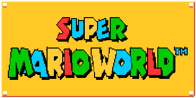

<h1 align="center">Super Mario World</h1>

  

  🍄 Plataforma 2D · 🎮 Godot 4.6 · 💻 GDScript

## ✨ Sobre o jogo

**Super Mario World** é um jogo de plataforma 2D que desenvolvi como projeto acadêmico de Ciência da Computação. É um tributo independente e não oficial ao clássico da Nintendo.

Atravesse **quatro fases**, colete moedas e desvie de inimigos e armadilhas antes que o tempo acabe. Pelo caminho, você pode bater em blocos, pegar cogumelos para transformar o Mario e atravessar trechos de natação.

As fases têm plataformas móveis, prensas, Koopas com cascos deslizantes e esqueletos que arremessam ossos. O HUD mostra vidas, moedas, pontuação e tempo restante.

## 🎨 Arte dos cenários

  
  
  
  

## 🎮 Controles

| Tecla | Ação |
| --- | --- |
| `A` / `D` | Mover para a esquerda / direita |
| `Espaço` ou `F` | Pular ou subir na água |
| `Shift` | Agachar |

## 🚀 Como jogar

### Pelo Godot

1. Instale o [Godot 4.6](https://godotengine.org/download/archive/4.6-stable/).
2. Clone este repositório ou baixe e extraia o ZIP do código-fonte.
3. No gerenciador de projetos do Godot, importe o arquivo `project.godot`.
4. Aguarde a importação dos recursos, pressione `F5` e use `Espaço` na tela inicial.

### No Windows

Se você tiver a versão exportada, mantenha `Super Mario World.exe` e `Super Mario World.pck` na mesma pasta e abra o executável.

## 📁 Estrutura do projeto

| Pasta | Conteúdo |
| --- | --- |
| [`Cenas/`](Cenas/) | Menu inicial, quatro fases e telas de vitória e derrota |
| [`Entidades/`](Entidades/) | Cenas reutilizáveis do personagem, inimigos, blocos e armadilhas |
| [`Scripts/`](Scripts/) | Lógica em GDScript para movimentação, inimigos, câmera e interface |
| [`Sprites/`](Sprites/), [`Tiles/`](Tiles/) e [`Fontes/`](Fontes/) | Arte dos cenários, animações e fontes |
| [`Sons/`](Sons/) | Áudio do jogo |

O movimento do Mario usa aceleração e desaceleração. Uma máquina de estados organiza ações como pular, cair e nadar, e um script global mantém vidas, moedas e pontuação entre as fases.

## 📜 Créditos

*Super Mario World* e os personagens da franquia pertencem à Nintendo. Os recursos de terceiros pertencem a seus respectivos titulares. O projeto foi desenvolvido para fins acadêmicos e não possui vínculo com a Nintendo.

